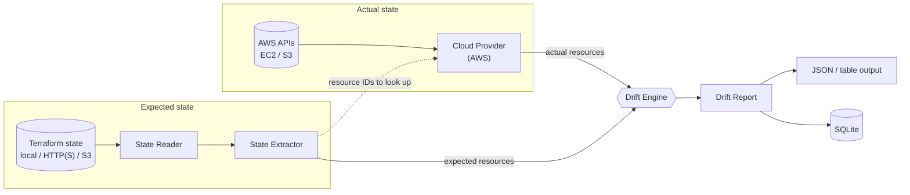
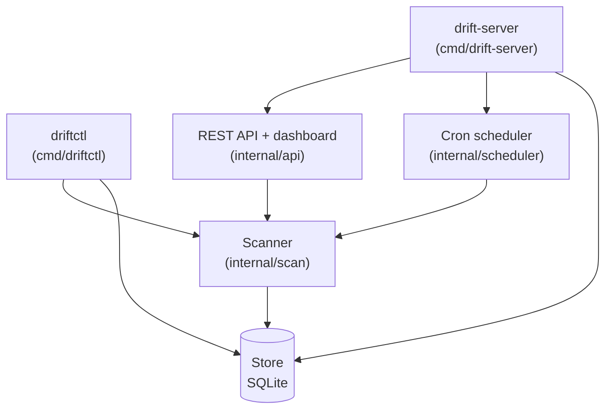
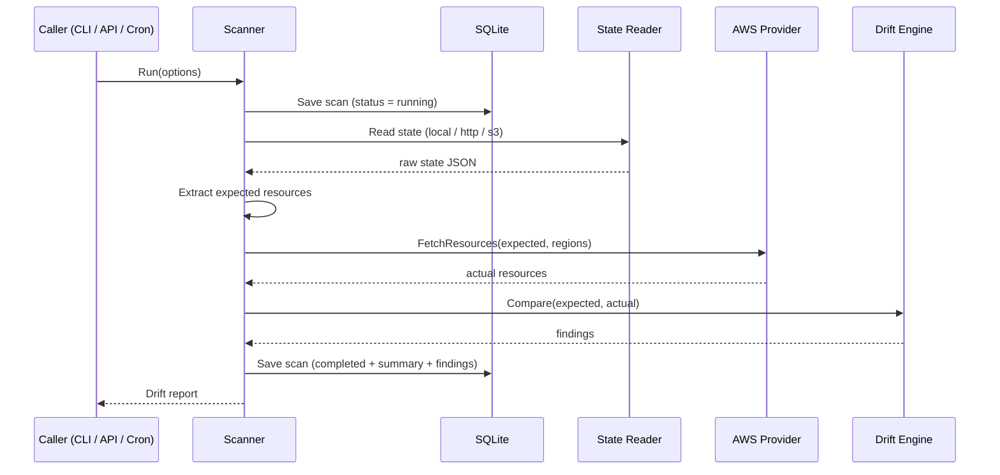
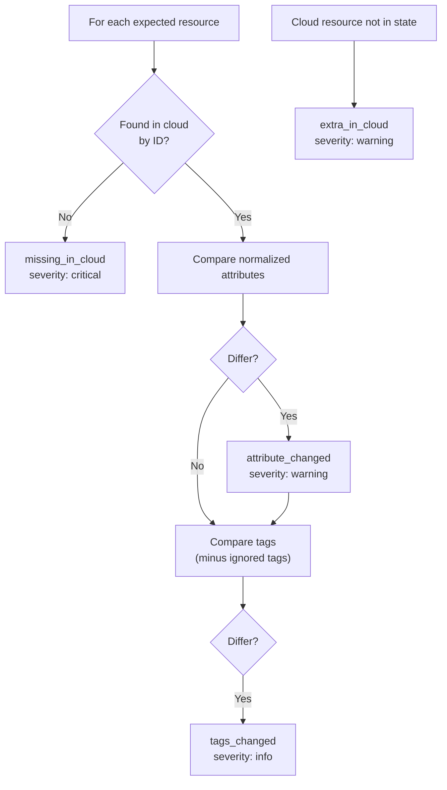

<div align="center">

# 🔍 driftctl

### Terraform drift detection — without `terraform plan`

Compare your Terraform state against live cloud infrastructure from a **CLI**, a **REST API**, or a **web dashboard**, on demand or on a cron schedule.

<br>

[](go.mod)
[](#supported-aws-resources)
[](#architecture)
[](LICENSE)

<br>

[**Quick Start**](#-quick-start) · [**Architecture**](#-architecture) · [**CLI**](#-cli-reference) · [**REST API**](#-rest-api) · [**Configuration**](#-configuration) · [**Limitations**](#-current-limitations)

</div>

---

## 📖 Table of Contents

- [Overview](#-overview)
- [Features](#-features)
- [Architecture](#-architecture)
- [Tech Stack](#-tech-stack)
- [Project Structure](#-project-structure)
- [Quick Start](#-quick-start)
- [Configuration](#-configuration)
- [CLI Reference](#-cli-reference)
- [REST API](#-rest-api)
- [Web Dashboard](#-web-dashboard)
- [How Drift Is Detected](#-how-drift-is-detected)
- [Testing](#-testing)
- [Troubleshooting](#-troubleshooting)
- [Extending](#-extending)
- [Current Limitations](#-current-limitations)
- [Roadmap](#-roadmap)
- [License](#-license)

---

## 🧭 Overview

Infrastructure drifts. Someone edits a security group in the console, a tag gets removed, an instance is resized by hand — and Terraform state quietly stops matching reality.

**driftctl** reads the *expected* state from a Terraform state file, fetches the *actual* state from the cloud provider's APIs, normalizes both into one resource model, and reports the differences. It never runs `terraform plan` or `terraform apply`, so it is **read-only** with respect to your infrastructure.

Scan results are persisted in SQLite, so you can re-open any past report from the CLI, the API, or the dashboard.

---

## ✨ Features

<table>
  <tr>
    <td width="50%" valign="top">

**🗂 Flexible state sources**
Local file, HTTP(S) URL, or S3 object.

**☁️ Live cloud comparison**
AWS: EC2 instances, VPCs, subnets, security groups, S3 buckets.

**🧮 Normalized resource model**
State and cloud data are mapped to one `Resource` shape before comparison.

    </td>
    <td width="50%" valign="top">

**🚨 Four drift categories**
Missing in cloud, extra in cloud, attribute changed, tags changed — each with a severity.

**⏱ On-demand and scheduled scans**
Trigger via CLI or REST API; schedule per workspace with cron expressions.

**📊 Multiple outputs**
Table (CLI), JSON, and a built-in web dashboard.

    </td>
  </tr>
  <tr>
    <td valign="top">

**🧪 CI-friendly exit codes**
`0` no drift · `1` drift detected · `2` error.

    </td>
    <td valign="top">

**💾 Persistent history**
Workspaces, scans, and schedules stored in SQLite.

    </td>
  </tr>
</table>

---

## 🏗 Architecture

Expected and actual infrastructure are built through two parallel pipelines and meet in the drift engine.



The entry points sit on top of a shared scanner:



### Scan sequence



### Design notes

| Decision | Detail |
| --- | --- |
| **Provider interface** | Cloud providers implement `providers.CloudProvider` (`Name`, `FetchResources`, `SupportedTypes`) and register in a registry, so new providers plug in without touching the scanner. |
| **Normalization before comparison** | State and cloud attributes are mapped to a fixed set of compare keys per resource type; numeric values are normalized through JSON before equality checks. |
| **Concurrent regional fetch** | The AWS provider fetches each region in its own goroutine. |
| **Partial-failure tolerance** | Fetch errors are recorded on the report; an AWS fetch only fails outright if nothing at all could be retrieved. |
| **Single store abstraction** | A `store.Store` interface, backed by SQLite, is shared by the CLI, API, and scheduler. |

---

## 🧰 Tech Stack

<div align="center">


</div>

| Layer | Technology |
| --- | --- |
| Language | Go 1.24 (`go.mod`) |
| CLI | [`spf13/cobra`](https://github.com/spf13/cobra) |
| Cloud SDK | [`aws-sdk-go-v2`](https://github.com/aws/aws-sdk-go-v2) (`config`, `ec2`, `s3`) |
| Scheduling | [`robfig/cron/v3`](https://github.com/robfig/cron) |
| Persistence | SQLite via [`mattn/go-sqlite3`](https://github.com/mattn/go-sqlite3) |
| Config | YAML via `gopkg.in/yaml.v3` |
| IDs | `google/uuid` |
| API server | Go standard library `net/http` (method-based routing) |
| Dashboard | Vanilla HTML, CSS, and JavaScript (no build step) |

---

## 📁 Project Structure

```text
.
├── cmd/
│   ├── driftctl/            # CLI entry point (scan, report, workspace, schedule)
│   └── drift-server/        # API server + dashboard + scheduler entry point
├── configs/
│   └── driftctl.yaml        # Example configuration
├── internal/
│   ├── api/                 # REST handlers, API-key middleware, dashboard serving
│   ├── config/              # YAML config loading and defaults
│   ├── drift/               # Drift engine (+ tests)
│   ├── model/               # Resource, finding, report, workspace types
│   ├── output/              # JSON and table formatters
│   ├── providers/
│   │   ├── provider.go      # CloudProvider interface + registry
│   │   └── aws/             # EC2/VPC/subnet/SG and S3 fetchers
│   ├── scan/                # Scan orchestration (+ tests)
│   ├── scheduler/           # Cron-based scheduled scans
│   ├── state/               # State readers (local/HTTP/S3) and extractor (+ tests)
│   └── store/               # Store interface + SQLite implementation
├── testdata/state/
│   └── sample.tfstate       # Sample state: 1 VPC, 1 EC2 instance, 1 S3 bucket
├── web/
│   ├── index.html           # Dashboard
│   └── static/              # app.js, style.css
├── Makefile
├── go.mod
└── LICENSE
```

---

## 🚀 Quick Start

### Prerequisites

| Requirement | Notes |
| --- | --- |
| **Go 1.24+** | Required by `go.mod`. The Makefile adds `/usr/local/go/bin` to `PATH`. |
| **C compiler (cgo)** | `mattn/go-sqlite3` is a cgo package; install `gcc` (or equivalent) if the build complains. |
| **AWS credentials** | Only for live scans. Resolved through the standard AWS SDK default credential chain (environment variables, shared config/profile, instance role, …). |

### 1. Clone and build

```bash
git clone https://github.com/iam-veeramalla/terraform-drift-detector.git
cd terraform-drift-detector
make build
```

This produces two binaries in `bin/`: `driftctl` (CLI) and `drift-server` (API + dashboard).

### 2. Try it offline with the sample state

```bash
make run-scan
# equivalent to:
./bin/driftctl scan --state testdata/state/sample.tfstate --provider aws --skip-cloud
```

> [!NOTE]
> `--skip-cloud` skips the cloud fetch entirely, so no actual resources are available to compare. Every resource in the state file is therefore reported as `missing_in_cloud`, and the command exits with code `1`. It exercises the pipeline without AWS credentials; it does not represent a real drift result.

### 3. Run a live AWS scan

```bash
# Local state file
./bin/driftctl scan \
  --state /path/to/terraform.tfstate \
  --provider aws \
  --region us-east-1

# State stored in S3
./bin/driftctl scan \
  --state-bucket my-tf-state \
  --state-key prod/terraform.tfstate \
  --state-region us-east-1 \
  --region us-east-1
```

### 4. Start the API server and dashboard

```bash
make run-server
# Dashboard + API at http://localhost:8080
```

> [!IMPORTANT]
> Run the server **from the repository root**. The dashboard files are served from the relative paths `web/index.html` and `web/static/`, and the default config path is `configs/driftctl.yaml`.

### Exit codes

| Code | Meaning |
| :---: | --- |
| `0` | Scan completed, no drift |
| `1` | Scan completed, drift detected |
| `2` | Error |

### Make targets

| Target | Action |
| --- | --- |
| `make build` | Build `bin/driftctl` and `bin/drift-server` |
| `make test` | `go test ./...` |
| `make run-server` | Build, then start the server with `configs/driftctl.yaml` |
| `make run-scan` | Build, then scan the sample state with `--skip-cloud` |
| `make clean` | Remove `bin/` |

---

## ⚙️ Configuration

Configuration is a YAML file (default for the server: `configs/driftctl.yaml`). The file shipped in the repository:

```yaml
database: driftctl.db

api:
  addr: ":8080"
  # api_key: "change-me-in-production"

workspaces:
  - name: prod
    provider: aws
    state:
      backend: local
      path: testdata/state/sample.tfstate
    regions:
      - us-east-1
    compare:
      ignore_tags:
        - driftctl_scan
    schedule:
      cron: "0 */6 * * *"
```

### Options

| Key | Description | Default |
| --- | --- | --- |
| `database` | SQLite database file | `driftctl.db` |
| `api.addr` | Server listen address | `:8080` |
| `api.api_key` | If set, API requests must send it in the `X-API-Key` header | unset (no auth) |
| `workspaces[].name` / `provider` | Workspace identity and cloud provider (`aws`) | — |
| `workspaces[].state` | State source (see below) | — |
| `workspaces[].regions` | Regions to scan | derived from state, else `us-east-1` |
| `workspaces[].compare.ignore_tags` | Tag keys to ignore | — |
| `workspaces[].compare.ignore_attributes` | Attribute keys to ignore | — |
| `workspaces[].schedule.cron` | Cron expression for scheduled scans | — |

### State backends

<details>
<summary><b>Local file</b></summary>

```yaml
state:
  backend: local        # "file" is accepted as an alias
  path: /path/to/terraform.tfstate
```
</details>

<details>
<summary><b>S3</b></summary>

```yaml
state:
  backend: s3
  bucket: my-tf-state
  key: prod/terraform.tfstate
  region: us-east-1     # falls back to us-east-1 if omitted
```
</details>

<details>
<summary><b>HTTP(S)</b></summary>

```yaml
state:
  backend: https        # "http" is also accepted
  path: https://example.com/terraform.tfstate   # the URL goes in `path`
```
</details>

### Credentials and IAM permissions

driftctl uses the AWS SDK default credential chain; no credentials are read from the config file. The API calls the code makes are all read-only:

| Purpose | AWS actions |
| --- | --- |
| Read state from S3 | `s3:GetObject` |
| EC2 / VPC resources | `ec2:DescribeInstances`, `ec2:DescribeVpcs`, `ec2:DescribeSubnets`, `ec2:DescribeSecurityGroups` |
| S3 bucket resources | `s3:GetBucketLocation`, `s3:GetBucketTagging`, `s3:GetBucketVersioning` |

> [!WARNING]
> Never commit credentials or a real `api_key`. `.env` and `*.db` files are already in `.gitignore`.

---

## 💻 CLI Reference

```bash
driftctl [--config <path>] <command>
```

| Command | Description |
| --- | --- |
| `scan` | Run a drift scan |
| `report <scan-id>` | Show a saved report |
| `workspace list` | List workspaces (JSON) |
| `schedule create` | Create or update a workspace's cron schedule |

### `scan` flags

| Flag | Description | Default |
| --- | --- | --- |
| `--workspace` | Use a configured workspace by name | — |
| `--state` | Path to a local `terraform.tfstate` | — |
| `--state-bucket` / `--state-key` / `--state-region` | Read state from S3 | — |
| `--provider` | Cloud provider | `aws` |
| `--region` | Region to scan (repeatable) | — |
| `--output` | `table` or `json` | `table` |
| `--skip-cloud` | State-only mode (see note above) | `false` |

Either `--workspace`, `--state`, or `--state-bucket` is required.

### Examples

```bash
# Scan a workspace defined in config
driftctl scan --config configs/driftctl.yaml --workspace prod

# Ad-hoc scan with JSON output
driftctl scan --state terraform.tfstate --provider aws --output json

# View a saved report
driftctl report <scan-id> --output table

# List workspaces
driftctl workspace list

# Schedule a workspace (daily at 06:00)
driftctl schedule create --workspace prod --cron "0 6 * * *"
```

> [!NOTE]
> `schedule create` writes the schedule to the database. The scheduler runs inside `drift-server`, which loads stored schedules at startup.

---

## 🌐 REST API

Served by `drift-server`. When `api.api_key` is configured, send it as `X-API-Key`; `/health`, `/` and `/static/*` are exempt.

| Method | Endpoint | Description |
| :---: | --- | --- |
| `GET` | `/health` | Health check |
| `GET` | `/api/v1/workspaces` | List workspaces |
| `POST` | `/api/v1/workspaces` | Create a workspace |
| `GET` | `/api/v1/workspaces/{id}` | Get a workspace |
| `DELETE` | `/api/v1/workspaces/{id}` | Delete a workspace |
| `POST` | `/api/v1/workspaces/{id}/scans` | Run a scan (synchronous) and return the report |
| `GET` | `/api/v1/workspaces/{id}/scans` | List a workspace's scans (`?limit=`, default 50) |
| `GET` | `/api/v1/scans` | List recent scans |
| `GET` | `/api/v1/scans/{id}` | Get a scan |
| `GET` | `/api/v1/scans/{id}/report` | Get the report (`?format=json` default, or `table`) |
| `PUT` | `/api/v1/workspaces/{id}/schedules` | Set a cron schedule |
| `DELETE` | `/api/v1/workspaces/{id}/schedules` | Remove a schedule |

```bash
curl -s http://localhost:8080/health

# With an API key configured
curl -s -H "X-API-Key: $DRIFTCTL_API_KEY" http://localhost:8080/api/v1/workspaces
```

---

## 🖥 Web Dashboard

Open `http://localhost:8080` after starting the server. It is a dependency-free HTML/CSS/JS page that talks to the REST API and shows:

- **Workspaces** — one card per workspace with a **Run Scan** button
- **Recent Scans** — click a scan to open its report
- **Drift Report** — summary counts plus a findings table

---

## 🔎 How Drift Is Detected

<div align="center">



</div>

| Finding | Meaning | Severity |
| --- | --- | :---: |
| `missing_in_cloud` | In state, not found in the cloud | `critical` |
| `attribute_changed` | A compared attribute differs (`field`, `expected`, `actual` recorded) | `warning` |
| `tags_changed` | A tag was added, removed, or changed | `info` |
| `extra_in_cloud` | Present in the cloud set but not in state | `warning` |

Tags named `terraform` and `driftctl_scan` are always ignored, in addition to any `compare.ignore_tags`.

### Supported AWS resources

| Terraform type | Compared attributes |
| --- | --- |
| `aws_instance` | `instance_type`, `ami`, `vpc_security_group_ids`, `subnet_id`, `monitoring` |
| `aws_vpc` | `cidr_block`, `enable_dns_hostnames`, `enable_dns_support`, `instance_tenancy` |
| `aws_subnet` | `cidr_block`, `vpc_id`, `map_public_ip_on_launch`, `availability_zone` |
| `aws_security_group` | `description`, `vpc_id`, `ingress`, `egress` |
| `aws_s3_bucket` | `acl`, `force_destroy`, `versioning` |

### Report shape

Each scan produces a `DriftReport`:

```text
scan_id · workspace · status (running | completed | failed)
started_at · completed_at
summary  → total_resources, missing_in_cloud, extra_in_cloud, attribute_changes, tag_changes, total_findings
findings → kind, resource_id, resource_type, resource_name, field, expected, actual, severity
errors   → fetch/read errors, if any
```

---

## 🧪 Testing

```bash
make test
# or
go test ./...
```

The repository includes unit tests for:

| Package | Covers |
| --- | --- |
| `internal/drift` | Engine comparison: missing resources and tag differences |
| `internal/scan` | Scanner run in `--skip-cloud` mode |
| `internal/state` | Terraform state extraction |

`testdata/state/sample.tfstate` is the shared fixture. There are no integration tests against real AWS.

---

## 🛠 Troubleshooting

<details>
<summary><b><code>go: command not found</code> / wrong Go version</b></summary>

`go.mod` requires Go 1.24. Check `go version`. The Makefile prepends `/usr/local/go/bin` to `PATH`; if Go is installed elsewhere, put it on your `PATH` yourself.
</details>

<details>
<summary><b>Build errors mentioning cgo or <code>gcc</code></b></summary>

`mattn/go-sqlite3` needs a C toolchain and `CGO_ENABLED=1`. Install `gcc` (for example `build-essential` on Debian/Ubuntu).
</details>

<details>
<summary><b>Dashboard returns 404 or an empty page</b></summary>

Start the server from the repository root so `web/index.html` and `web/static/` resolve.
</details>

<details>
<summary><b>Every resource shows as <code>missing_in_cloud</code></b></summary>

Either `--skip-cloud` was used, the region doesn't match where the resources live, or the credentials lack the read permissions listed above. Check the `errors` field of the report.
</details>

<details>
<summary><b>HTTP 401 from the API</b></summary>

`api.api_key` is set. Send it in the `X-API-Key` header.
</details>

<details>
<summary><b><code>either --workspace, --state, or --state-bucket is required</code></b></summary>

`scan` needs one state source. See [CLI Reference](#-cli-reference).
</details>

---

## 🔌 Extending

**Add a cloud provider** — implement `providers.CloudProvider` in `internal/providers/` and register it in `providers.DefaultRegistry()`:

```go
type CloudProvider interface {
    Name() string
    FetchResources(ctx context.Context, expected []model.Resource, regions []string) ([]model.Resource, error)
    SupportedTypes() []string
}
```

**Add a resource type** — extend the compare keys in the state extractor (`internal/state/extractor.go`) and add the matching fetch logic in the provider.

---

## ⚠️ Current Limitations

Stated plainly, so you know what to expect:

- **AWS only.** The provider registry ships with AWS; other providers are an extension point, not an implemented feature.
- **Lookups are driven by state.** The AWS fetchers query the resource IDs found in the Terraform state. The `extra_in_cloud` category exists in the engine, but the current AWS provider does not enumerate unmanaged resources in your account.
- **Five resource types** are supported (see the table above).
- **Scans via the API are synchronous**: the `POST .../scans` request returns once the scan finishes.
- **No auth by default.** Set `api.api_key` before exposing the server.
- The repository does not currently include a Dockerfile, CI workflow, or dashboard screenshots.

---

## 🗺 Roadmap

Ideas only; none of these are implemented yet.

- [ ] Discover unmanaged resources (true `extra_in_cloud` detection)
- [ ] Additional providers (Azure, GCP) via the provider interface
- [ ] More AWS resource types
- [ ] Container image and CI workflow
- [ ] Notifications on drift

---

## 📄 License

Licensed under the **Apache License 2.0**. See [`LICENSE`](LICENSE) for the full text and [`NOTICE`](NOTICE) for attribution.

Copyright © 2026 [Kumar-Devansh](https://github.com/Kumar-Devansh). Based on the original work by [Abhishek Veeramalla](https://github.com/iam-veeramalla/terraform-drift-detector).

---

<div align="center">

**[Repository](https://github.com/iam-veeramalla/terraform-drift-detector)** · **[Issues](https://github.com/iam-veeramalla/terraform-drift-detector/issues)** · **[Pull Requests](https://github.com/iam-veeramalla/terraform-drift-detector/pulls)**

Maintained by [Kumar-Devansh](https://github.com/Kumar-Devansh) · Original project by [Abhishek Veeramalla](https://github.com/iam-veeramalla/terraform-drift-detector), built with the Cursor agent.

</div>
